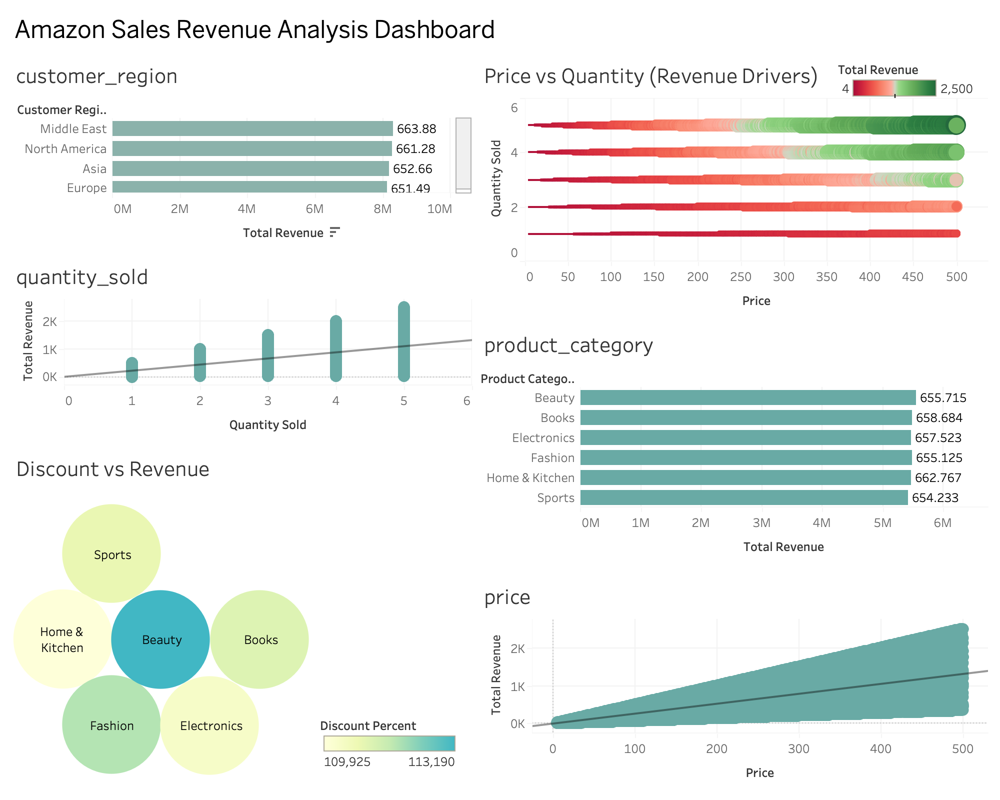

# Amazon Sales Revenue Project

An interactive Tableau dashboard analyzing Amazon's sales revenue trends, product performance, and key financial metrics.

## Live Interactive Dashboard
[**Click here to view the live interactive dashboard on Tableau Public**](https://public.tableau.com/app/profile/arafa.mohamed6310/viz/Amazonsalesrevenueproject/Dashboard1)

## Dashboard Previews
Below are static snapshots of the multi-page dashboard. 

### Page: Sales Performance Overview

Dashboard visualizes total revenue performance across product categories, regions, pricing levels, and time trends to identify key revenue drivers. It highlights that revenue is primarily influenced by price and quantity sold.

## Tools Used
* **Tableau Desktop** - Data visualization and dashboard design
* **GitHub** - Project documentation and version control
